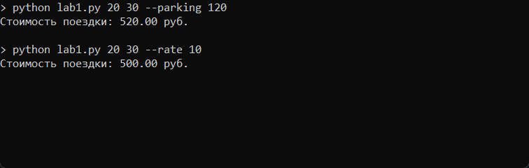
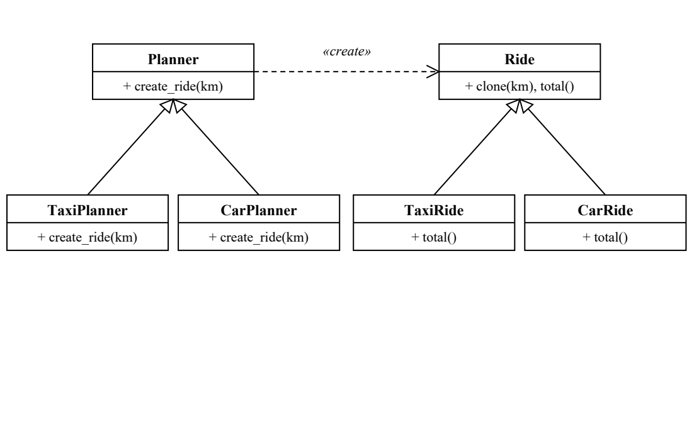
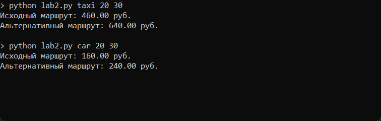
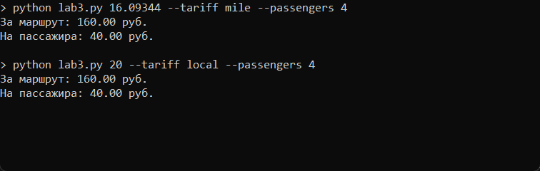

# Расчёт стоимости поездки

Три консольные лабораторные работы по паттернам проектирования. Вариант 11.

## Запуск

Требуется Python 3.8 или новее. Из корня проекта выполните:

```sh
python lab1.py 20 30 --parking 120
python lab2.py taxi 20 30
python lab3.py 16.09344 --tariff mile --passengers 4
```

## Архитектура

Каждый модуль содержит классы своей лабораторной и точку входа командной строки. Общий модуль `money.py` проверяет числовой ввод и округляет денежный результат до копеек. Отчёты находятся в `docx/`, диаграммы и снимки консоли в `images/`.

## Лабораторные работы

| ЛР | Паттерны | Модуль | Отчёт | Статус |
|---|---|---|---|---|
| 1 | Строитель | [lab1.py](lab1.py) | [Word](docx/ЛР-1.docx) | Готово |
| 2 | Фабричный метод и Прототип | [lab2.py](lab2.py) | [Word](docx/ЛР-2.docx) | Готово |
| 3 | Адаптер и Мост | [lab3.py](lab3.py) | [Word](docx/ЛР-3.docx) | Готово |

## Как пользоваться

В ЛР1 перечислите длины участков через пробел. Параметры `--rate` и `--parking` задают цену километра и плату за стоянку. В ЛР2 укажите `taxi` или `car` и две длины маршрута. В ЛР3 выберите тариф `local` или `mile` и задайте число пассажиров. Расстояние всегда вводится в километрах.

## ЛР 1. Строитель

Собрать смету поездки из участков маршрута и платы за стоянку.

Участки добавляются по мере планирования. Строитель хранит их длины и сумму платежей за стоянку. Вызов build проверяет, что маршрут содержит хотя бы один участок, и переносит длины в кортеж. Поэтому последующее изменение строителя не меняет смету.

| Роль | Класс | Назначение |
|---|---|---|
| Строитель | TripBuilder | Накапливает участки и платежи. Метод build создаёт поездку. |
| Продукт | Trip | Хранит параметры готовой сметы и вычисляет итог. |

```python
# TripBuilder
def build(self):
    if not self.legs:
        raise ValueError("Добавьте участок маршрута")
    return Trip(tuple(self.legs), self.rate, self.parking)
# Trip
def total(self):
    return sum(self.legs) * self.rate + self.parking
```


### Проверка

При тарифе 8 руб./км два участка длиной 20 и 30 км стоят 400 руб. Стоянка добавляет 120 руб., итог равен 520 руб. Во втором запуске тариф равен 10 руб./км, стоянка отсутствует. За те же 50 км программа начисляет 500 руб.



## ЛР 2. Фабричный метод и Прототип

Сравнить стоимость исходного и альтернативного маршрутов для выбранного транспорта.

Planner.compare вызывает фабричный метод create_ride. Конкретный планировщик определяет класс поездки. Затем clone создаёт копию того же класса с новой длиной. Оба объекта рассчитывают стоимость по правилам своего транспорта.

| Роль | Класс | Назначение |
|---|---|---|
| Создатель | Planner | Задаёт порядок сравнения и объявляет фабричный метод. |
| Конкретные создатели | TaxiPlanner, CarPlanner | Создают поездку для такси или автомобиля. |
| Продукт и прототип | Ride | Объявляет total и реализует копирование через replace. |
| Конкретные продукты | TaxiRide, CarRide | Задают правила оплаты поездки. |

```python
# Planner
def compare(self, km, alternative_km):
    original = self.create_ride(km)
    alternative = original.clone(alternative_km)
    return original.total(), alternative.total()
# TaxiPlanner
def create_ride(self, km):
    return TaxiRide(km)
# Ride
def clone(self, km):
    return replace(self, km=km)
```



### Проверка

Такси берёт 100 руб. за подачу и 18 руб./км. При длине 20 км цена равна 460 руб., при 30 км получается 640 руб. Для личного автомобиля действует ставка 8 руб./км. Те же маршруты стоят 160 и 240 руб.



## ЛР 3. Адаптер и Мост

Подключить счётчик с оплатой за милю и рассчитать цену маршрута целиком или на пассажира.

Адаптер реализует метод price(km), переводит километры в мили и вызывает quote_miles. Мост связывает смету с интерфейсом Tariff. Вид сметы и тариф выбираются независимо: один тариф подходит и для общего итога, и для расчёта доли пассажира.

| Роль | Класс | Назначение |
|---|---|---|
| Целевой интерфейс | Tariff | Принимает расстояние в километрах. |
| Адаптер | MileAdapter | Переводит километры в мили для MileMeter. |
| Адаптируемый класс | MileMeter | Начисляет 16 руб. за милю. |
| Абстракция | Estimate | Делегирует расчёт выбранному тарифу. |
| Уточнение | SharedEstimate | Делит стоимость маршрута на число пассажиров. |
| Реализации | LocalTariff, MileAdapter | Рассчитывают цену через местный тариф или счётчик. |

```python
# MileAdapter
def price(self, km):
    return self.meter.quote_miles(km / Decimal("1.609344"))
# Estimate
def cost(self, km):
    return self.tariff.price(km)
# SharedEstimate
def cost(self, km):
    return super().cost(km) / self.passengers
```


### Проверка

16,09344 км составляют 10 миль. При ставке 16 руб./миля цена равна 160 руб. При местном тарифе та же сумма получается за 20 км по 8 руб./км. Обе поездки для четырёх пассажиров дают по 40 руб. на человека.


