# Расчёт стоимости поездки

Пятнадцать консольных лабораторных работ по паттернам проектирования. Вариант 11.

## Запуск

Требуется Python 3.8 или новее. Из корня проекта выполните:

```sh
python lab1.py 20 30 --parking 120
python lab2.py taxi 20 30
python lab3.py 16.09344 --tariff mile --passengers 4
```

## Архитектура

Каждый модуль содержит классы своей лабораторной и точку входа командной строки. Общий модуль `money.py` проверяет числовой ввод и округляет денежный результат до копеек. Отчёты находятся в `docx/`, диаграммы и снимки консоли в `images/`.

## Лабораторные работы

| ЛР | Паттерны | Модуль | Отчёт | Статус |
|---|---|---|---|---|
| 1 | Строитель | [lab1.py](lab1.py) | [Word](docx/ЛР-1.docx) | Готово |
| 2 | Фабричный метод и Прототип | [lab2.py](lab2.py) | [Word](docx/ЛР-2.docx) | Готово |
| 3 | Адаптер и Мост | [lab3.py](lab3.py) | [Word](docx/ЛР-3.docx) | Готово |
| 4 | Компоновщик и Декоратор | [lab4.py](lab4.py) | [Word](docx/ЛР-4.docx) | Готово |
| 5 | Фасад и Приспособленец | [lab5.py](lab5.py) | [Word](docx/ЛР-5.docx) | Готово |
| 6 | Заместитель | [lab6.py](lab6.py) | [Word](docx/ЛР-6.docx) | Готово |
| 7 | Команда и Итератор | [lab7.py](lab7.py) | [Word](docx/ЛР-7.docx) | Готово |
| 8 | Цепочка обязанностей | [lab8.py](lab8.py) | [Word](docx/ЛР-8.docx) | Готово |
| 9 | Посредник и Снимок | [lab9.py](lab9.py) | [Word](docx/ЛР-9.docx) | Готово |
| 10 | Наблюдатель и Состояние | [lab10.py](lab10.py) | [Word](docx/ЛР-10.docx) | Готово |
| 11 | Стратегия и Шаблонный метод | [lab11.py](lab11.py) | [Word](docx/ЛР-11.docx) | Готово |
| 12 | Архитектура MVC | [lab12.py](lab12.py) | [Word](docx/ЛР-12.docx) | Готово |
| 13 | Журнал событий (Event Sourcing) | [lab13.py](lab13.py) | [Word](docx/ЛР-13.docx) | Готово |
| 14 | Преобразователь данных (Data Mapper) | [lab14.py](lab14.py) | [Word](docx/ЛР-14.docx) | Готово |
| 15 | Производитель и потребитель (Producer–Consumer) | [lab15.py](lab15.py) | [Word](docx/ЛР-15.docx) | Готово |

## Как пользоваться

В ЛР1 перечислите длины участков через пробел. Параметры `--rate` и `--parking` задают цену километра и плату за стоянку. В ЛР2 укажите `taxi` или `car` и две длины маршрута. В ЛР3 выберите тариф `local` или `mile` и задайте число пассажиров. Расстояние всегда вводится в километрах.

## ЛР 1. Строитель

Собрать смету поездки из участков маршрута и платы за стоянку.

Участки добавляются по мере планирования. Строитель хранит их длины и сумму платежей за стоянку. Вызов build проверяет, что маршрут содержит хотя бы один участок, и переносит длины в кортеж. Поэтому последующее изменение строителя не меняет смету.

| Роль | Класс | Назначение |
|---|---|---|
| Строитель | TripBuilder | Накапливает участки и платежи. Метод build создаёт поездку. |
| Продукт | Trip | Хранит параметры готовой сметы и вычисляет итог. |

```python
# TripBuilder
def build(self):
    if not self.legs:
        raise ValueError("Добавьте участок маршрута")
    return Trip(tuple(self.legs), self.rate, self.parking)
# Trip
def total(self):
    return sum(self.legs) * self.rate + self.parking
```

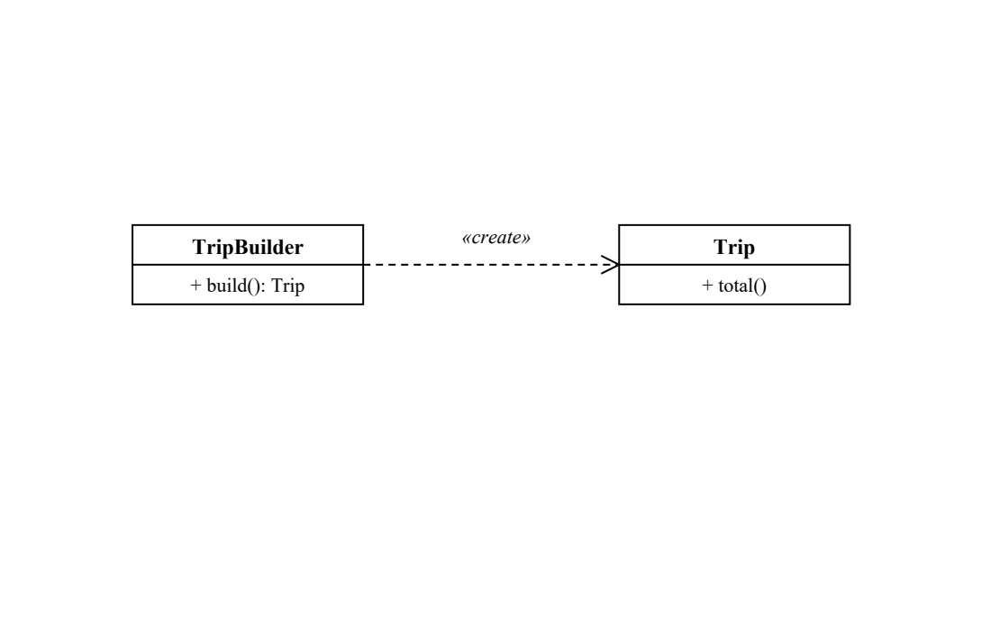

### Проверка

При тарифе 8 руб./км два участка длиной 20 и 30 км стоят 400 руб. Стоянка добавляет 120 руб., итог равен 520 руб. Во втором запуске тариф равен 10 руб./км, стоянка отсутствует. За те же 50 км программа начисляет 500 руб.


## ЛР 2. Фабричный метод и Прототип

Сравнить стоимость исходного и альтернативного маршрутов для выбранного транспорта.

Planner.compare вызывает фабричный метод create_ride. Конкретный планировщик определяет класс поездки. Затем clone создаёт копию того же класса с новой длиной. Оба объекта рассчитывают стоимость по правилам своего транспорта.

| Роль | Класс | Назначение |
|---|---|---|
| Создатель | Planner | Задаёт порядок сравнения и объявляет фабричный метод. |
| Конкретные создатели | TaxiPlanner, CarPlanner | Создают поездку для такси или автомобиля. |
| Продукт и прототип | Ride | Объявляет total и реализует копирование через replace. |
| Конкретные продукты | TaxiRide, CarRide | Задают правила оплаты поездки. |

```python
# Planner
def compare(self, km, alternative_km):
    original = self.create_ride(km)
    alternative = original.clone(alternative_km)
    return original.total(), alternative.total()
# TaxiPlanner
def create_ride(self, km):
    return TaxiRide(km)
# Ride
def clone(self, km):
    return replace(self, km=km)
```


### Проверка

Такси берёт 100 руб. за подачу и 18 руб./км. При длине 20 км цена равна 460 руб., при 30 км получается 640 руб. Для личного автомобиля действует ставка 8 руб./км. Те же маршруты стоят 160 и 240 руб.


## ЛР 3. Адаптер и Мост

Подключить счётчик с оплатой за милю и рассчитать цену маршрута целиком или на пассажира.

Адаптер реализует метод price(km), переводит километры в мили и вызывает quote_miles. Мост связывает смету с интерфейсом Tariff. Вид сметы и тариф выбираются независимо: один тариф подходит и для общего итога, и для расчёта доли пассажира.

| Роль | Класс | Назначение |
|---|---|---|
| Целевой интерфейс | Tariff | Принимает расстояние в километрах. |
| Адаптер | MileAdapter | Переводит километры в мили для MileMeter. |
| Адаптируемый класс | MileMeter | Начисляет 16 руб. за милю. |
| Абстракция | Estimate | Делегирует расчёт выбранному тарифу. |
| Уточнение | SharedEstimate | Делит стоимость маршрута на число пассажиров. |
| Реализации | LocalTariff, MileAdapter | Рассчитывают цену через местный тариф или счётчик. |

```python
# MileAdapter
def price(self, km):
    return self.meter.quote_miles(km / Decimal("1.609344"))
# Estimate
def cost(self, km):
    return self.tariff.price(km)
# SharedEstimate
def cost(self, km):
    return super().cost(km) / self.passengers
```

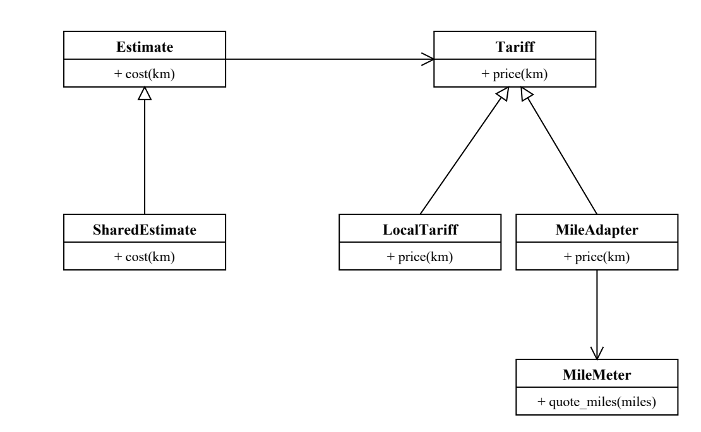

### Проверка

16,09344 км составляют 10 миль. При ставке 16 руб./миля цена равна 160 руб. При местном тарифе та же сумма получается за 20 км по 8 руб./км. Обе поездки для четырёх пассажиров дают по 40 руб. на человека.


## ЛР 4. Компоновщик и Декоратор

Рассчитать общую стоимость участков пути и применить скидку только к проезду.

Group суммирует дочерние объекты через общий метод total. Группа участков оборачивается в Discount. Корневая группа объединяет проезд со скидкой и отдельную плату за стоянку.

| Роль | Класс | Назначение |
|---|---|---|
| Компонент | Expense | Задаёт общий метод total. |
| Лист | Charge | Возвращает отдельную сумму. |
| Компоновщик | Group | Суммирует дочерние расходы. |
| Декоратор | Discount | Снижает сумму вложенного расхода. |

```python
# Group
def total(self):
    return sum(item.total() for item in self.items)

# Discount
def total(self):
    return self.expense.total() * (100 - self.percent) / 100
```

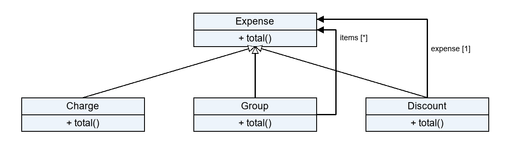

### Проверка

```sh
python lab4.py 20 30 --parking 120 --discount 10
```

Два участка общей длиной 50 км по 8 руб./км стоят 400 руб. Со скидкой 10 % и стоянкой за 120 руб. итог равен 480 руб. Без скидки программа выводит 520 руб.

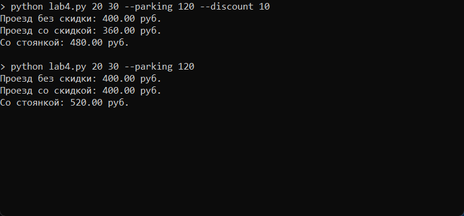

## ЛР 5. Фасад и Приспособленец

Рассчитать маршрут через несколько тарифных зон и использовать общий объект для повторяющихся зон.

RouteFacade принимает список участков. Для каждого участка фасад получает тариф из TariffPool и передаёт ему расстояние. Название зоны и ставка хранятся в неизменяемом ZoneTariff. Длина участка передаётся при вызове и в пуле не сохраняется.

| Роль | Класс | Назначение |
|---|---|---|
| Фасад | RouteFacade | Предоставляет метод estimate. |
| Фабрика приспособленцев | TariffPool | Выдаёт один тариф на зону. |
| Приспособленец | ZoneTariff | Хранит общую ставку и рассчитывает цену. |

```python
# RouteFacade
def estimate(self, legs):
    return sum(self.pool.get(zone).cost(km) for zone, km in legs)

# TariffPool
def get(self, zone):
    if zone not in self.tariffs:
        self.tariffs[zone] = ZoneTariff(zone, self.rates[zone])
    return self.tariffs[zone]
```

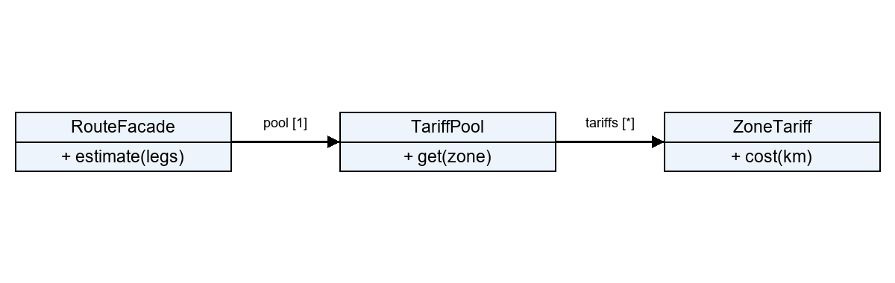

### Проверка

```sh
python lab5.py city:10 road:20 city:5
```

В городе километр стоит 10 руб., на трассе 8 руб. Маршрут из участков 10, 20 и 5 км стоит 100 + 160 + 50 = 310 руб. Трём участкам нужны два объекта тарифа. Для двух участков трассы длиной 10 и 15 км достаточно одного объекта, цена составляет 200 руб.

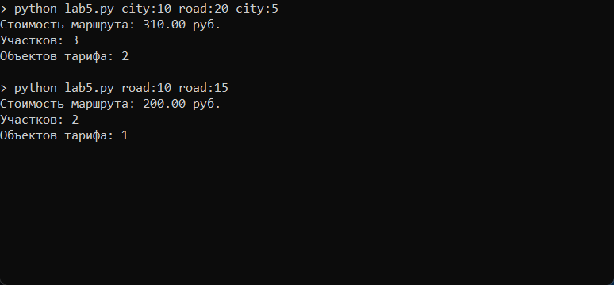

## ЛР 6. Заместитель

Исключить повторные вычисления для одинаковых запросов стоимости такси.

CachedService реализует тот же метод quote, что и TaxiService. При первом запросе заместитель передаёт расстояние сервису и запоминает результат. При повторе возвращает сохранённую сумму. Кэш действует в пределах одного запуска при фиксированном тарифе.

| Роль | Класс | Назначение |
|---|---|---|
| Интерфейс | QuoteService | Объявляет метод quote. |
| Реальный сервис | TaxiService | Начисляет 100 руб. за подачу и 18 руб./км. |
| Заместитель | CachedService | Хранит цены ранее рассчитанных поездок. |

```python
# CachedService
def quote(self, km):
    if km not in self.cache:
        self.cache[km] = self.service.quote(km)
    return self.cache[km]

# TaxiService
def quote(self, km):
    self.calls += 1
    return 100 + km * 18
```

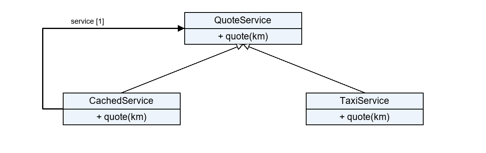

### Проверка

```sh
python lab6.py 20 30 20
```

Для расстояний 20, 30 и снова 20 км программа выводит 460, 640 и 460 руб. Сервис выполняет два вычисления для трёх запросов. Во втором запуске три запроса по 10 км дают по 280 руб., счётчик вычислений равен единице.

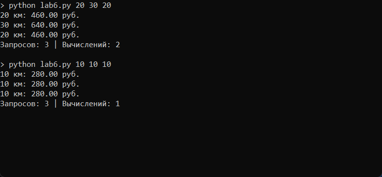


## ЛР 7. Команда и Итератор

Добавлять участки маршрута, отменять последнее добавление и рассчитывать стоимость по оставшимся участкам.

Editor выполняет объект AddLeg и помещает его в историю. Команда хранит маршрут и длину участка. При отмене редактор извлекает последнюю команду и вызывает undo. Метод Route.__iter__ выдаёт новый итератор списка: стоимость и перечень участков вычисляются обходом одного маршрута.

| Роль | Участник | Назначение |
|---|---|---|
| Инициатор | Editor | Выполняет и отменяет команды. |
| Команда | AddLeg | Добавляет участок и отменяет добавление. |
| Получатель и коллекция | Route | Хранит участки и предоставляет обход. |
| Итератор | list_iterator | Последовательно выдаёт длины участков. |

```python
# Editor
def undo(self):
    if not self.history:
        raise ValueError("Нет команды для отмены")
    self.history.pop().undo()

# AddLeg
def execute(self):
    self.route.legs.append(self.distance)

# Route
def __iter__(self):
    return iter(self.legs)
```

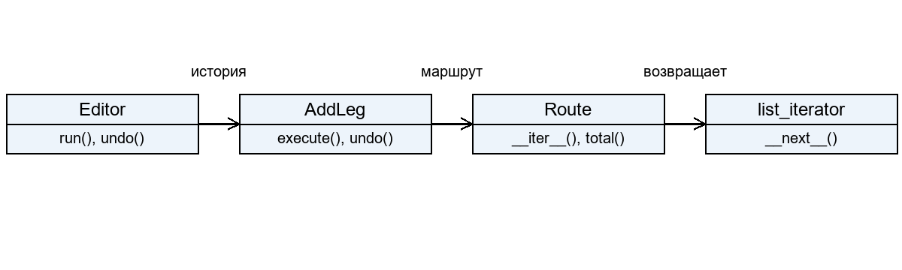

### Проверка

```sh
python lab7.py 20 30 undo 10
```

После добавления 20 и 30 км команда undo убирает участок 30 км. Новый участок длиной 10 км даёт маршрут 20 + 10 км. Цена при ставке 8 руб./км равна 240 руб. Во втором примере отменён единственный участок, поэтому итог равен нулю.

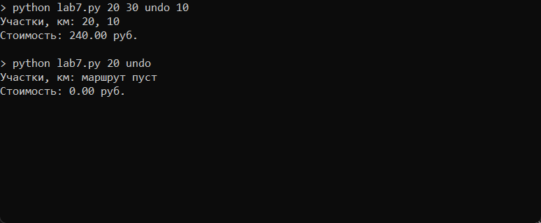

## ЛР 8. Цепочка обязанностей

Определить, кто может согласовать смету поездки, и показать пройденные ступени проверки.

У каждого обработчика ApprovalStep есть название, включительный лимит и ссылка на следующую ступень. Координатор согласует до 500 руб., руководитель до 2000 руб., директор до 5000 руб. При превышении порога обработчик передаёт запрос дальше. Если цепочка исчерпана, заявка отклоняется.

| Роль | Участник | Назначение |
|---|---|---|
| Обработчик | ApprovalStep | Сравнивает цену с собственным лимитом. |
| Следующая ступень | successor | Ссылка на обработчик с большим лимитом. |
| Сборка цепочки | approval_chain | Связывает три экземпляра в порядке полномочий. |

```python
# ApprovalStep
def review(self, cost, trace):
    trace.append(self.title)
    if cost <= self.limit:
        return f"Согласовано: {self.title}"
    if self.successor is not None:
        return self.successor.review(cost, trace)
    return "Отклонено: превышен максимальный лимит"
```

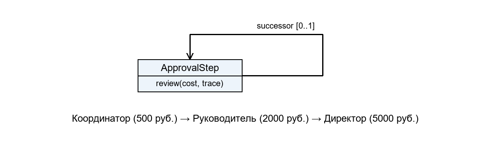

### Проверка

```sh
python lab8.py 200 --parking 150
```

За 200 км по 8 руб./км и стоянку в 150 руб. запрошено 1750 руб. Координатор передаёт заявку руководителю, который её согласует. Поездка на 700 км стоит 5600 руб. Запрос проходит все три ступени и получает отказ.

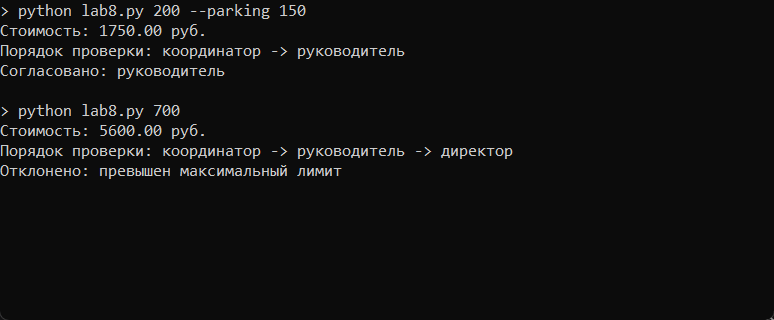

## ЛР 9. Посредник и Снимок

Синхронизировать смету с маршрутом и восстановить сохранённое расстояние после изменения.

Route сообщает посреднику об изменении расстояния. TripMediator передаёт актуальное значение в Estimate, который рассчитывает стоимость. При save маршрут создаёт неизменяемый Snapshot. Команда restore возвращает расстояние из последнего снимка и запускает тот же пересчёт сметы.

| Роль | Участник | Назначение |
|---|---|---|
| Посредник | TripMediator | Согласует маршрут и смету. |
| Создатель снимка | Route | Сохраняет и восстанавливает расстояние. |
| Снимок | Snapshot | Хранит сохранённое расстояние. |
| Компонент сметы | Estimate | Пересчитывает цену по ставке 8 руб./км. |

```python
# Route
def restore(self, snapshot):
    self.set_distance(snapshot.distance)

# TripMediator
def route_changed(self):
    self.estimate.update(self.route.distance)

# Route
def save(self):
    return Snapshot(self.distance)
```

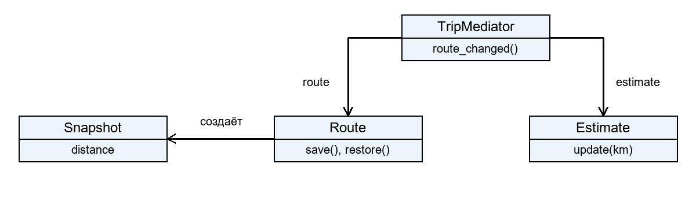

### Проверка

```sh
python lab9.py 20 save 45 restore
```

Маршрут 20 км стоит 160 руб. После сохранения изменение до 45 км повышает цену до 360 руб. Восстановление возвращает 20 км и 160 руб. Во втором запуске сохранены 25 км: после изменения до 30 км восстановленная смета составляет 200 руб.

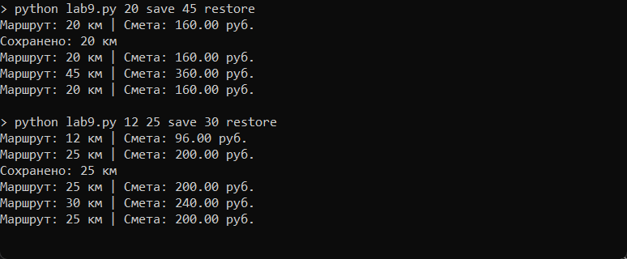


## ЛР 10. Наблюдатель и Состояние

Пересчитывать смету при изменении маршрута и запретить правки после подтверждения поездки.

Trip передаёт запрос текущему состоянию. В состоянии Draft можно изменить расстояние и подтвердить поездку. После перехода в Confirmed повторное подтверждение и изменение расстояния вызывают ошибку. После каждого успешного действия Trip уведомляет подписчиков. Подписчик show_quote получает актуальное состояние, расстояние и выводит смету по ставке 8 руб./км.

| Роль | Участник | Назначение |
|---|---|---|
| Издатель | Trip | Хранит состояние и список подписчиков. |
| Наблюдатель | show_quote | Выводит смету после уведомления. |
| Состояния | Draft, Confirmed | Разрешают или отклоняют действия. |

```python
# Trip
def change(self, distance):
    self.state.change(self, distance)
    self.notify()

# Trip
def notify(self):
    for listener in self.listeners:
        listener(self)

# Draft
def confirm(self, trip):
    trip.state = Confirmed()
```

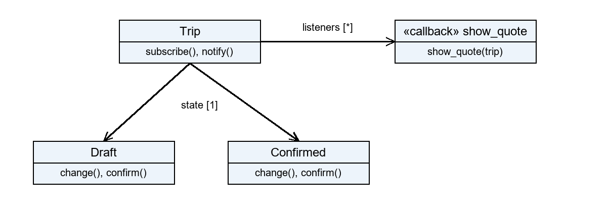

### Проверка

```sh
python lab10.py 10 25 confirm
```

После изменения расстояния с 10 до 25 км стоимость возрастает с 80 до 200 руб. Подтверждение сохраняет цену и меняет статус. Во втором запуске после подтверждения 20 км программа отклоняет попытку указать 30 км. Нового уведомления о стоимости нет.

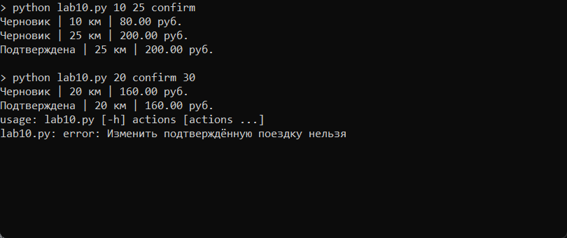

## ЛР 11. Стратегия и Шаблонный метод

Сравнить стоимость поездки на личном автомобиле и такси при одинаковом маршруте и плате за стоянку.

Calculator получает стратегию тарификации при создании. Общий метод Fare.total складывает подачу, проезд и стоянку. Подклассы задают стоимость проезда. Для автомобиля подача бесплатна, а TaxiFare переопределяет этот шаг и начисляет 100 руб.

| Роль | Участник | Назначение |
|---|---|---|
| Контекст | Calculator | Передаёт расчёт выбранному тарифу. |
| Базовая стратегия | Fare | Метод total задаёт порядок расчёта. |
| Стратегии | CarFare, TaxiFare | Определяют стоимость подачи и километра. |

```python
# Fare
def total(self, km, parking):
    return self.boarding() + self.travel(km) + parking

# Calculator
def estimate(self, km, parking):
    return self.fare.total(km, parking)

# TaxiFare
def travel(self, km):
    return km * 18
```

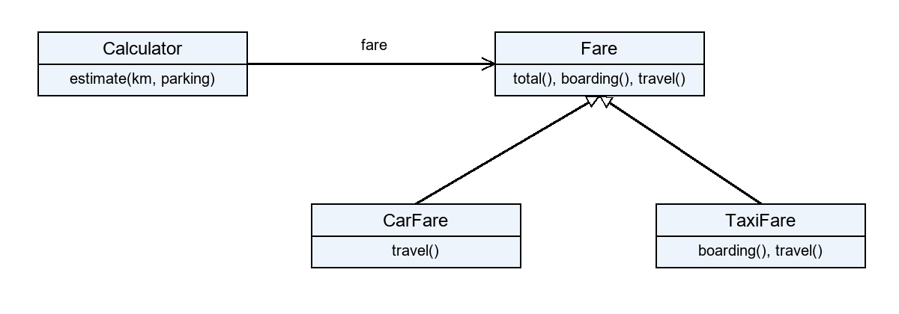

### Проверка

```sh
python lab11.py taxi 20 --parking 40
```

За 20 км на автомобиле начисляется 160 руб. При стоянке за 40 руб. итог равен 200 руб. Для такси подача стоит 100 руб., проезд стоит 360 руб., и с той же стоянкой получается 500 руб.

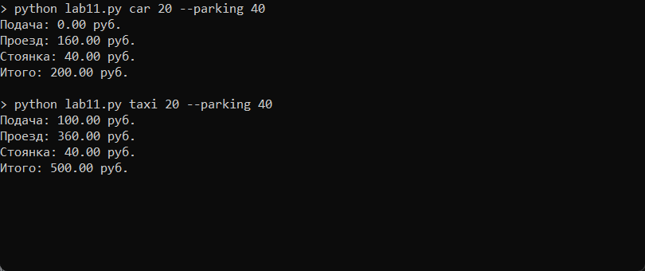

## ЛР 12. Архитектура MVC

Разделить ввод параметров, вычисление стоимости и вывод сметы на роли контроллера, модели и представления.

Контроллер получает параметры командной строки и создаёт TripModel. Модель проверяет число пассажиров, умножает расстояние на цену километра, добавляет стоянку и вычисляет долю пассажира. Контроллер передаёт модель в ConsoleView. Представление выводит обе суммы с округлением до копеек.

| Роль | Участник | Назначение |
|---|---|---|
| Модель | TripModel | Хранит параметры, рассчитывает итог и долю. |
| Представление | ConsoleView | Форматирует и выводит суммы. |
| Контроллер | TripController | Создаёт модель и вызывает представление. |

```python
# TripController
def calculate(self, km, rate, parking, passengers):
    model = TripModel(km, rate, parking, passengers)
    self.view.show(model)

# TripModel
def total(self):
    return self.km * self.rate + self.parking

# TripModel
def share(self):
    return self.total() / self.passengers
```

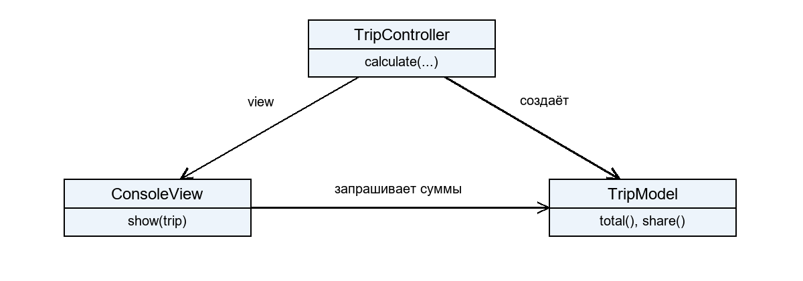

### Проверка

```sh
python lab12.py 40 --parking 80 --passengers 4
```

Поездка на 40 км при ставке 8 руб./км и стоянке за 80 руб. стоит 400 руб. Доля каждого из четырёх пассажиров равна 100 руб. Во втором запуске при 15 км и ставке 12 руб./км двое пассажиров платят по 90 руб.

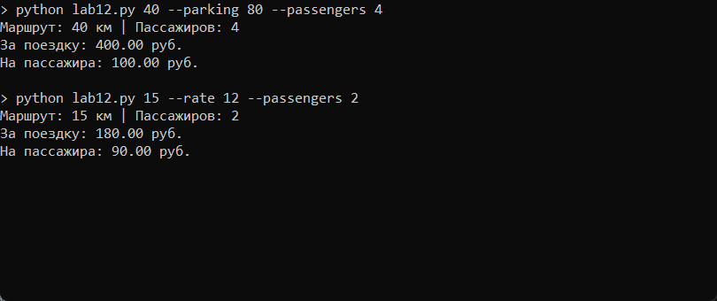


## ЛР 13. Журнал событий (Event Sourcing)

Получить смету поездки на разных этапах маршрута по последовательности зарегистрированных событий.

TripLog хранит в памяти процесса неизменяемые события. LegAdded фиксирует длину участка, ParkingPaid фиксирует оплату стоянки. Версия соответствует числу учтённых событий. Метод balance начинает с нуля и применяет события до указанной версии. Добавление стоянки меняет текущий итог, но не результат воспроизведения ранней версии.

| Роль | Участник | Назначение |
|---|---|---|
| Журнал | TripLog | Добавляет события и восстанавливает сумму. |
| Событие участка | LegAdded | Прибавляет стоимость пути по 8 руб./км. |
| Событие стоянки | ParkingPaid | Прибавляет уплаченную сумму. |

```python
# TripLog
def balance(self, version):
    if not 0 <= version <= len(self._events):
        raise ValueError("Версия вне журнала")
    total = Decimal(0)
    for event in self._events[:version]:
        total = event.apply(total)
    return total

# ParkingPaid
def apply(self, total):
    return total + self.fee
```

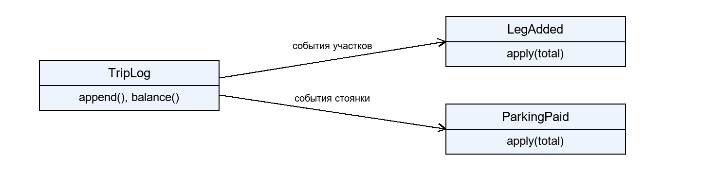

### Проверка

```sh
python lab13.py 20 30 --parking 120
```

Два участка на 20 и 30 км стоят 400 руб. После добавления стоянки итог равен 520 руб. Воспроизведение версии до второго участка возвращает 160 руб. Во втором запуске соответствующие суммы составляют 200, 240 и 80 руб.

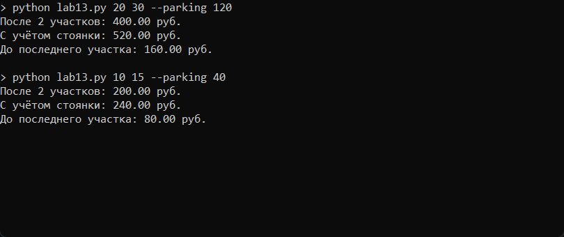

## ЛР 14. Преобразователь данных (Data Mapper)

Сохранить параметры поездки в SQLite и восстановить объект для повторного расчёта.

TripMapper записывает расстояние и плату за стоянку в текстовые столбцы, сохраняя точность Decimal. При чтении преобразователь находит строку по ключу, восстанавливает числа и создаёт Trip. Объект поездки содержит формулу стоимости. При указании файла базы следующий процесс может прочитать ту же запись.

| Роль | Участник | Назначение |
|---|---|---|
| Объект предметной области | Trip | Рассчитывает цену поездки. |
| Преобразователь | TripMapper | Преобразует объект в строку таблицы и обратно. |
| Хранилище | SQLite | Хранит параметры и назначает номер записи. |

```python
# TripMapper
def load(self, trip_id):
    row = self.db.execute("SELECT km, parking FROM trips WHERE id = ?",
                          (trip_id,)).fetchone()
    if row is None:
        raise KeyError(trip_id)
    return Trip(Decimal(row[0]), Decimal(row[1]))

# Trip
def total(self):
    return self.km * 8 + self.parking
```

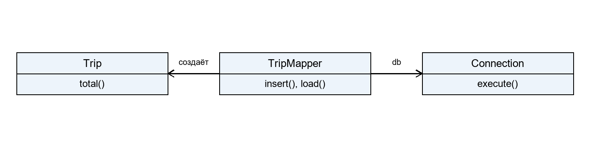

### Проверка

```sh
python lab14.py --db trips.db add 25 --parking 60
python lab14.py --db trips.db show 1
```

На пустой базе команда add сохраняет поездку под номером 1. Проезд на 25 км стоит 200 руб., со стоянкой получается 260 руб. Второй запуск открывает тот же файл и по ключу 1 получает тот же маршрут и итог.

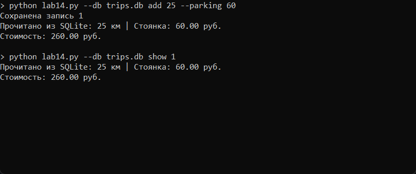

## ЛР 15. Производитель и потребитель (Producer–Consumer)

Передать серию заявок из основного потока в рабочий и рассчитать стоимость каждой поездки.

QuoteProducer помещает пары «номер, расстояние» в очередь вместимостью две заявки. Отдельный поток QuoteConsumer забирает их в порядке поступления и рассчитывает цену по ставке 8 руб./км. После последней заявки производитель отправляет маркер None. Основной поток дожидается завершения потребителя и выводит результаты.

| Роль | Участник | Назначение |
|---|---|---|
| Производитель | QuoteProducer | Нумерует и передаёт заявки. |
| Буфер | Queue | Синхронизирует потоки и ограничивает размер очереди. |
| Потребитель | QuoteConsumer | Обрабатывает заявки до маркера завершения. |

```python
# QuoteProducer
def submit_all(self, distances):
    for number, km in enumerate(distances, 1):
        self.requests.put((number, km))
    self.requests.put(None)

# QuoteConsumer
def run(self):
    while True:
        job = self.requests.get()
        if job is None:
            return
        number, km = job
        self.results.append((number, km, km * 8))
```

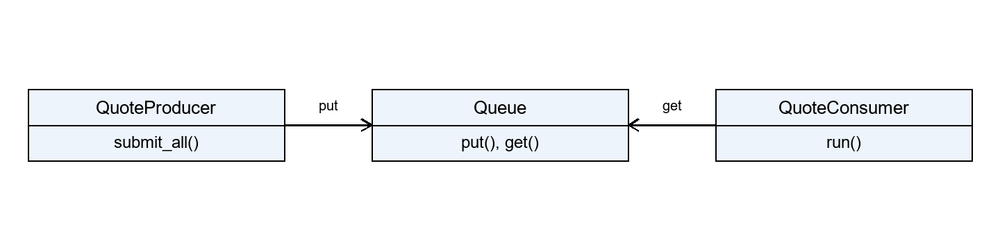

### Проверка

```sh
python lab15.py 10 25 40
```

Для расстояний 10, 25 и 40 км программа выводит 80, 200 и 320 руб. Во втором запуске две заявки по 15 км получают разные номера и цену по 120 руб. Заявка на 0 км обрабатывается с ценой 0 руб. В обоих запусках обработано по три заявки.

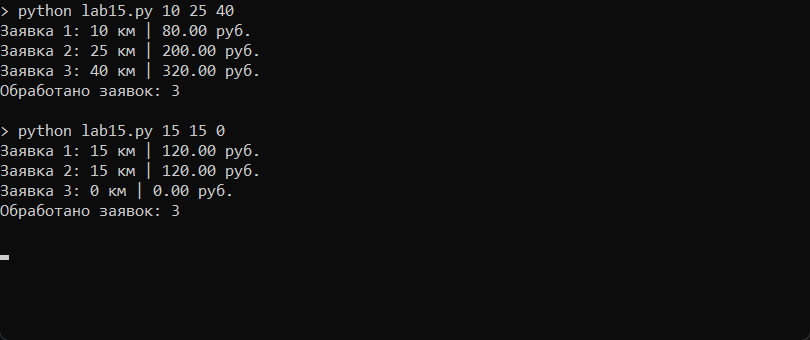
